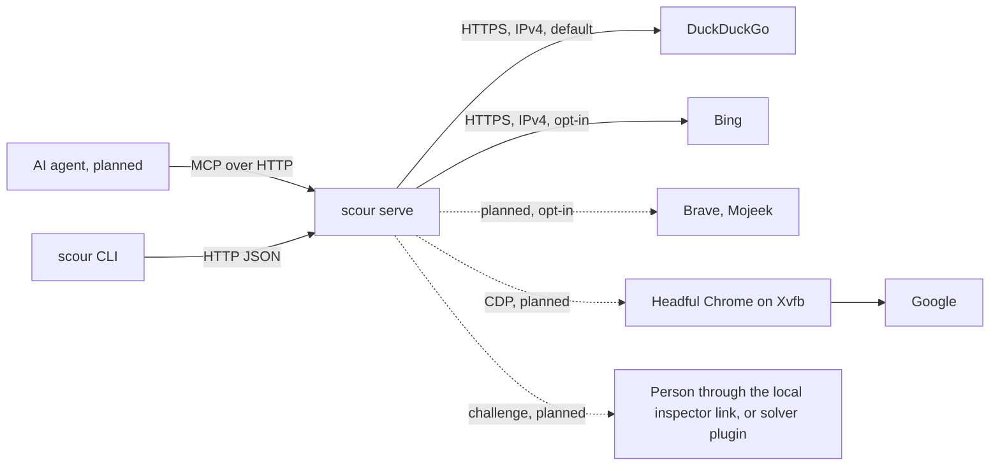

# Architecture

scour is one Rust binary. It runs as one local daemon (`scour serve`), and the agents on the machine use it.
Today the daemon asks DuckDuckGo by default and Bing only if a person turns it on. It uses an HTTP client that has
a browser TLS fingerprint. It listens only on `127.0.0.1:7268`. No flag, variable or file changes that address.
A cascade, MCP, and a browser for Google are planned too. The browser is headful Chrome on Xvfb (a virtual
display). It runs as a child process, and the daemon drives it through CDP (the Chrome DevTools Protocol) with
`chromiumoxide`.

The main reason for this shape: blocks come mostly from the IP and from the fingerprint, not from the tool. Thus
most queries use the cheap tier. The release binary is 11957968 bytes. The idle daemon uses 9.2 MiB of memory.
Only a Google query pays for a browser.

## Context

## Parts

| Part | What it does | Technology | Status |
| --- | --- | --- | --- |
| Daemon | Serves the JSON API on `127.0.0.1:7268` only. MCP is planned. | `tokio`, `axum` | built |
| MCP endpoint | It has one tool, `search(query, engines?)`. It returns the results, the state of each engine, and the open challenges, each with a live link for a person. | `rmcp` (streamable HTTP) | planned |
| JSON API and CLI | `GET /search` returns JSON. `scour search "q"` is a client of this API in the same binary. | `axum`, `wreq` | built |
| Cascade | Selects the engines for a query and skips each engine that rests or is at its limit. It sends each HTTP engine through the HTTP tier, and each browser-only engine (Google) through the browser tier. It does not send a blocked HTTP engine to the browser, because a browser on a blocked IP does not help. It merges the results and removes duplicate URLs. | Rust | planned |
| Engines | Each engine makes the request URL and parses the page. One `Engine` struct holds the name, base URL, profile, URL builder and page reader. Each engine is one file with the same shape. There is no `Engine` trait, because a function pointer is enough for the engines. DuckDuckGo is built as the only default engine. It uses `https://html.duckduckgo.com/html/?q=<q>&kl=us-en`, and it reads the target URL from the `uddg=` parameter of each `/l/` redirect link. Bing is built as an opt-in engine. Brave and Mojeek are planned as opt-in engines. Brave gave a CAPTCHA page to `wreq` from the first query, so it may need the browser tier. Mojeek has no saved result page. Google is planned for the browser tier. In the saved Google result page, each result link is an opaque `/goto?url=` token, and the token does not contain the target URL as text. The `<cite>` text is not a full URL either. How the Google engine gets the target URL is an open question in `docs/vision.md`. | `scraper` | built for DuckDuckGo and Bing |
| HTTP tier | Sends the DuckDuckGo and Bing requests with the Chrome TLS profile. Uses IPv4 only. One optional proxy is planned. | `wreq`, `wreq-util` | built for DuckDuckGo and Bing |
| Browser tier | Has one function, `fetch(url) -> Page \| Challenge`. It starts headful Chrome on an Xvfb display on the first browser query, or it connects to a CDP URL that the user gives. Chrome starts with `--password-store=basic` and `--use-mock-keychain`. Without them, Chromium hangs on the system keyring before it loads a page. The spikes kept Chrome on IPv4 with a local SOCKS5 proxy and `--host-resolver-rules`. How Chrome stays on IPv4 without a user proxy is not tested. It stops the browser after an idle time, but not while a challenge is open. Each CDP call has a timeout. The browser uses the same proxy as the HTTP tier. Its profile is in a temporary directory that the daemon deletes when the browser stops. Its CDP port listens on `127.0.0.1` only. | `chromiumoxide` 0.9 | planned |
| Engine state | DuckDuckGo and Bing report `ok` (1 or more results), `empty` (HTTP 200 and 0 results) or `error` (the request failed). `blocked`, `parse_failed`, the rest timer, the rate limit and the daily count are planned. When the only default engine rests, the answer has no results, the state `blocked` and the rest time. | Rust, in memory | built for DuckDuckGo and Bing |
| Challenge queue | Keeps each open CAPTCHA with an ID, a screenshot, a live link and an expiry time. The live link is the local Chrome inspector of the challenge tab. The agent passes it to a person. A solver plugin is planned for after the first release. The queue watches the tab for the done signal (refer to "Data"). It removes the challenge on the done signal or at expiry. | Rust; CDP target list | planned |
| Fixtures and canary | Saved DuckDuckGo and Bing pages test the parsers. Planned: `scour canary` sends one query to each engine and prints its health. Also planned: a saved Google result page and Google block page from the browser spike. | Rust tests | built for DuckDuckGo and Bing |
| Packaging | Has two Docker images. `scour` has only the binary and the cheap engines. `scour:browser` adds Chrome and Xvfb. The installed Chromium of the browser spike is 437 MB, so `scour:browser` is several hundred MB. The image size is not measured yet. On a Linux host without Docker, the user installs Chrome and Xvfb, and sets the path of Chrome. | Docker, static musl binary | planned |

## Data

- **Search result.** `GET /search?q=<text>` returns JSON. It has `query`, `results[]` with `url`, `title`,
  `content`, `engine` and `position`, and `engines[]` with `name` and `state`. `engines[].error` is present only
  when the state is `error`. A missing `q`, or a query of only spaces, returns HTTP 400. `challenges[]` is
  planned. The field names are the same as in SearXNG, so the format is familiar. We do not promise SearXNG
  compatibility, and we copy no SearXNG code (AGPL). The API ignores other parameters, so a client that sends
  `format=json` still works.
- **Challenge.** This shape is planned: `{id, engine, kind, page_url, live_url, expires_at}`. A screenshot is not in the shape, because only a solver plugin would use it.
  `kind` is `recaptcha`, `cloudflare` or `unknown`.
  - `live_url` is the local Chrome inspector of the challenge tab:
    `http://127.0.0.1:<port>/devtools/inspector.html?ws=127.0.0.1:<port>/devtools/page/<id>`. `<port>` is the CDP
    port, and `<id>` is the CDP target ID of the tab.
  - A person on another computer opens the link through `ssh -L <port>:127.0.0.1:<port> <host>`. The port number
    must be the same on both ends, because the link contains it.
  - An open reCAPTCHA widget expired approximately 2 minutes after a click, on a demo page. How long an unclicked
    Google `/sorry/` page stays solvable is not measured. Milestone 2 sets `expires_at` from a measurement.
  - The done signal for Google is the `GOOGLE_ABUSE_EXEMPTION` cookie, or a Google `/search` result page in the
    tab. The cookie expires approximately 3 hours after the solve. A URL that is no longer `/sorry/` is not enough,
    because the tab can go to a wrong page.
  - After the done signal, the challenge leaves `challenges[]`. The agent calls `search` again, and the browser
    session gives Google results.
- **Configuration.** One TOML file holds the enabled engines. The default path is `$XDG_CONFIG_HOME/scour/config.toml`,
  or `$HOME/.config/scour/config.toml`. The `engines` key is a list; it defaults to `["duckduckgo"]`, and a person
  can add `bing`. `scour serve --config <path>` reads another file. An unknown key, an unknown or duplicate engine
  name, an empty list, or a missing `--config` file stops the daemon with exit code 1. A TOML error shows the parser
  message and the line number, never the source line, so a secret in the file cannot leak. The listen address stays
  fixed at `127.0.0.1:7268`. A later milestone can add a listen flag for Docker. That change makes the localhost
  invariant weaker for that case, so the owner decides it then.
- **State.** The daemon writes no query and no result to disk. It prints one start line and no query. Rest
  timers and daily counts are planned, and they will live in memory. The browser profile is planned. The daemon
  will delete it when the browser stops. The `GOOGLE_ABUSE_EXEMPTION` cookie lives only in that profile, so a
  browser stop ends the solved session.
- **Between the parts.** The CLI talks to the daemon with HTTP JSON. The daemon does not talk to a browser yet.
  That path is CDP over WebSocket on `127.0.0.1`, and it is planned. A solver plugin is planned for after the first release. It
  would use JSON on stdin and stdout, or a JSON POST.

## Choices

- **Rust.** `wreq-util` has current Chrome, Firefox and Safari TLS profiles in pure Rust. The release binary is
  11957968 bytes and the idle daemon uses 9.2 MiB of memory. A static musl build with `wreq` works: the engine
  spike binary was 8.2 MB, with a peak of 28.8 MiB. We did not use Go, because its fingerprint client
  (`tls-client`) replaces `net/http` and its HTTP/2 layer has no licence file; `chromedp` is better than the Rust
  CDP clients, but the browser is a separate process in any language. We did not use Zig, because it has no library
  that gives HTTP a browser TLS fingerprint, no CDP client and no HTML parser.
- **One shared daemon.** All agents share one engine state and one rate limit. Thus two agents do not burn the same
  IP. We did not use one stdio process for each agent, because each process would count the rate limit alone.
- **DuckDuckGo as the only default engine.** In a paced 60-minute run from the home IP, cookie-free DuckDuckGo
  answered 60 of 60 queries, with no home-page visit and no cookie jar. 58% of its results matched all query words.
  Bing answered each query, but in the 24 plain HTTP variants only 0 of 238 results matched all query words.
  Headful Chrome matched 58% on 2 of 3 queries, so the client causes the mismatch. Brave gave HTTP 429 with a
  CAPTCHA, Mojeek gave HTTP 403, and Startpage, Qwant, Yahoo and Ecosia gave no results. We did not keep Bing as a
  default, because a result that does not match the query is worse than no result: the agent cannot see the
  difference. One default engine is a risk: when it rests, the answer is `blocked` with no results. The pace and
  daily limits keep the risk small.
- **The CDP client in the daemon.** `chromiumoxide` drives Chrome through all steps of a Google search, so
  `headless_chrome` is not necessary. A CDP endpoint is the replaceable boundary: a user can give the CDP URL of
  another browser. The handoff link comes from the same CDP server.
  - We did not use a separate `scour-browser` worker with a JSON protocol on stdin, because that protocol has only
    one user. A move to a worker later stays cheap, because all browser code is behind `fetch`.
  - We did not use the `agent-browser` CLI for each step. It starts one process for each step, and the user must
    install a second tool. It also gives less control of the fingerprint and of the live session that the handoff
    needs. A user can still connect scour to an `agent-browser` session through its CDP URL.
- **Headful Chrome on Xvfb.** It was the only browser that got parsed Google results from the home IP (2 of 2 in the
  last session; the first session got 2 reCAPTCHA pages). Obscura 0.2.7, Scrapling and headless Chrome each got
  reCAPTCHA pages (0 of 2). The first headful session also failed, so a short IP block during those rows is possible. We did not use Obscura, because it got no Google results, it has no library crate on
  crates.io, and its stealth build is 164 MB. We did not use headless Chrome, because Google blocked it. Headful
  Chrome also cleared a Cloudflare challenge on its second load. That test was not fair to the other browsers.
- **The browser as a child process, not a library.** A browser crash does not stop the daemon, and the binary stays
  small. Chrome is not available as a library. We did not link a V8 browser such as Obscura, because V8 makes the
  binary approximately 70 MB, a V8 crash stops the daemon, and Obscura got no Google results.
- **Cheap HTTP engines by default, Google opt-in.** DuckDuckGo answered each paced query in a median time of
  approximately 0.7 s. Google gave no results to raw HTTP or to replayed browser cookies. We did not use the browser
  for all engines, because headful Chrome on Xvfb used 1.7 to 2.0 GiB of peak memory and 3 to 11 s for each
  Google query in the spikes.
- **Avoid and hand off. No automatic solver in the core.** The daemon rests the engine, uses other engines and slows
  down. Then it gives the CAPTCHA to a person through a live link. An external solver plugin is planned for after the
  first release. We did not put
  a solver in the core, and we did not give the agent a `solve` tool, for four reasons:
  1. Google v. SerpApi (a DMCA 1201 case) is about automated circumvention of CAPTCHAs.
  2. A solver needs a paid account.
  3. A solver hides the blocks that the health states must show.
  4. Most models refuse to solve CAPTCHAs, and a reCAPTCHA grid needs many rounds of clicks, not one text answer.
- **The local Chrome inspector as the live link.** The owner solved a Google reCAPTCHA through it in 26 s, from
  another computer through an SSH tunnel. The same session then gave Google results on 5 of 5 searches. The link
  gives full control of the browser (`Runtime.evaluate`, `Network.getCookies`, `Page.navigate`), so it stays on
  `127.0.0.1`. A person on another computer uses an SSH tunnel.
  - We did not use the appspot `devtoolsFrontendUrl` that Chrome gives, because its socket closes and the page does
    not show.
  - We did not build a screencast page in the daemon. The inspector is sufficient, and a screencast page that
    connects to the CDP socket gives the same full control.
- **The done signal from the cookie or the result page.** The `GOOGLE_ABUSE_EXEMPTION` cookie and a Google `/search`
  result page show that Google accepted the solve. We did not use "the URL left `/sorry/`" alone, because a person
  can move the tab to a wrong page, and that would look like a solve.
- **One proxy, no rotation.** A user on a server with a flagged datacenter IP can send requests through a home or
  residential proxy. We did not build a rotating pool, because it needs its own health checks and it is the start
  of a scraping service.
- **Health from the parsed result count.** A page with HTTP 200 and 0 results is `empty`, not `ok`. A failed
  request is `error`. `parse_failed` is planned, so a page the parser cannot read is `empty` until then. We did
  not use the HTTP status alone, because silent empty pages stopped most earlier projects.
- **A browser only for browser-only engines.** A blocked HTTP engine rests. We did not send it to the browser,
  because the research showed that a browser on a blocked IP gets the same block.
- **IPv4 only.** IPv6 breaks DDG, Brave, Mojeek, Startpage and Qwant (SearXNG #6833).
- **State in memory.** This is the smallest store that works for one daemon. We did not use SQLite or a file. Add
  one if restarts reset the daily limits too often.
- **The CLI uses the JSON API, not an MCP client.** `curl` and SearXNG clients can use the same endpoint. The CLI
  needs no MCP session. We did not use an MCP client in the CLI, because it adds a session for one call.
- **Two Docker images.** Users who do not need Google do not download a browser. We did not use one image, because
  Chrome makes it several hundred MB larger: the installed Chromium is 437 MB. `scour:browser` has one browser,
  not two.

## Unknowns

The technical questions that are open are in "Open questions" in `docs/vision.md`, each with its spike.
