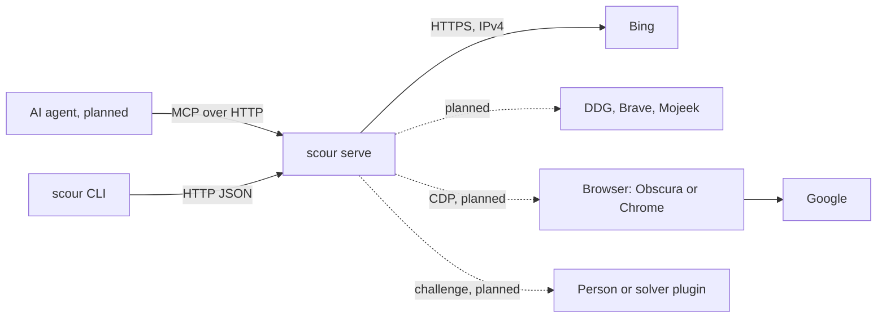

# Architecture

scour is one Rust binary. It runs as one local daemon (`scour serve`), and the agents on the machine use it.
The daemon asks Bing with an HTTP client that has a browser TLS fingerprint. It listens only on `127.0.0.1:7268`.
No flag, variable or file changes that address. A cascade, more engines, MCP, and a browser for Google are planned.
The browser would run as a separate child process and use CDP, the Chrome DevTools Protocol.

The main reason for this shape: blocks come mostly from the IP and from the fingerprint, not from the tool. Thus
most queries use the cheap tier. The release binary is 11688776 bytes. The idle daemon uses 9.1 MiB of memory.
Only a Google query pays for a browser.

## Context

## Parts

| Part | What it does | Technology | Status |
| --- | --- | --- | --- |
| Daemon | Serves the JSON API on `127.0.0.1:7268` only. MCP is planned. | `tokio`, `axum` | built |
| MCP endpoint | It has one tool, `search(query, engines?)`. It returns the results, the state of each engine, and the open challenges, each with a live link for a person. | `rmcp` (streamable HTTP) | planned |
| JSON API and CLI | `GET /search` returns JSON. `scour search "q"` is a client of this API in the same binary. | `axum`, `wreq` | built |
| Cascade | Selects the engines for a query and skips each engine that rests or is at its limit. It sends each HTTP engine through the HTTP tier, and each browser-only engine (Google) through the browser tier. It does not send a blocked HTTP engine to the browser, because a browser on a blocked IP does not help. It merges the results and removes duplicate URLs. | Rust | planned |
| Engines | Bing makes the request URL and parses the page. Each later engine is one file with the same shape. DuckDuckGo, Brave, Mojeek and Google are planned. There is no `Engine` trait until a second engine exists. | `scraper` | built for Bing |
| HTTP tier | Sends the Bing request with the Chrome TLS profile. Uses IPv4 only. One optional proxy is planned. | `wreq`, `wreq-util` | built for Bing |
| Browser tier | Has one function, `fetch(url) -> Page \| Challenge`. It starts the browser on the first browser query, or it connects to a CDP URL that the user gives. It stops the browser after an idle time, but not while a challenge is open. Each CDP call has a timeout. The browser uses the same proxy as the HTTP tier. Its profile is in a temporary directory that the daemon deletes when the browser stops. Its CDP port listens on `127.0.0.1` only. | `chromiumoxide` or `headless_chrome`; the browser spike selects one | planned |
| Engine state | Bing reports `ok` (1 or more results), `empty` (HTTP 200 and 0 results) or `error` (the request failed). `blocked`, `parse_failed`, the rest timer, the rate limit and the daily count are planned. | Rust, in memory | built for one engine |
| Challenge queue | Keeps each open CAPTCHA with an ID, a screenshot, a live link and an expiry time. It shows the CAPTCHA to a person through the live link, which the agent passes on, or sends it to a solver plugin. | Rust; CDP `devtoolsFrontendUrl` | planned |
| Fixtures and canary | Saved Bing pages test the parser. `scour canary` sends one query to each engine and prints its health. | Rust tests | built for Bing |
| Packaging | Has two Docker images: `scour` has only the binary and the cheap engines. `scour:browser` adds the one browser that the browser spike selects, and Xvfb (a virtual display) if that browser needs one. On a Linux host without Docker, the user installs a browser and sets its path. | Docker, static musl binary | planned |

## Data

- **Search result.** `GET /search?q=<text>` returns JSON. It has `query`, `results[]` with `url`, `title`,
  `content`, `engine` and `position`, and `engines[]` with `name` and `state`. `engines[].error` is present only
  when the state is `error`. A missing `q`, or a query of only spaces, returns HTTP 400. `challenges[]` is
  planned. The field names are the same as in SearXNG, so the format is familiar. We do not promise SearXNG
  compatibility, and we copy no SearXNG code (AGPL). The API ignores other parameters, so a client that sends
  `format=json` still works.
- **Challenge.** This shape is planned: `{id, engine, kind, page_url, screenshot (PNG), live_url?, expires_at}`.
  `kind` is `recaptcha`, `cloudflare` or `unknown`. A person solves the CAPTCHA in the live page. Then the agent
  calls `search` again. The handoff spike can change this shape.
- **Configuration.** One TOML file is planned. This version uses fixed defaults: Bing only, and
  `127.0.0.1:7268`. No flag changes the address. A later milestone can add a listen flag for Docker. That change
  makes the localhost invariant weaker for that case, so the owner decides it then.
- **State.** The daemon writes no query and no result to disk. It prints one start line and no query. Rest
  timers and daily counts are planned, and they will live in memory. The browser profile is planned. The daemon
  will delete it when the browser stops.
- **Between the parts.** The CLI talks to the daemon with HTTP JSON. The daemon does not talk to a browser yet.
  That path is CDP over WebSocket, and it is planned. A solver plugin is planned too. It would use JSON on stdin
  and stdout, or a JSON POST.

## Choices

- **Rust.** `wreq-util` has current Chrome, Firefox and Safari TLS profiles in pure Rust. The release binary is
  11688776 bytes and the idle daemon uses 9.1 MiB of memory. Obscura is Rust too. We did not use Go, because its fingerprint client
  (`tls-client`) replaces `net/http` and its HTTP/2 layer has no licence file; `chromedp` is better than the Rust
  CDP clients, but the browser is a separate process in any language. We did not use Zig, because it has no library
  that gives HTTP a browser TLS fingerprint, no CDP client and no HTML parser.
- **One shared daemon.** All agents share one engine state and one rate limit. Thus two agents do not burn the same
  IP. We did not use one stdio process for each agent, because each process would count the rate limit alone.
- **The CDP client in the daemon.** Obscura and Chrome are both CDP servers. Thus a CDP endpoint is the replaceable
  boundary, and no new protocol is necessary. The handoff link comes from the same connection. That `chromiumoxide`
  can drive Obscura, and that Obscura gives a live link, are not checked yet: the browser and handoff spikes check
  them.
  - We did not use a separate `scour-browser` worker with a JSON protocol on stdin, because that protocol has only
    one user. A move to a worker later stays cheap, because all browser code is behind `fetch`.
  - We did not use the `agent-browser` CLI for each step. It starts one process for each step, and the user must
    install a second tool. It also gives less control of the fingerprint and of the live session that the handoff
    needs. A user can still connect scour to an `agent-browser` session through its CDP URL.
- **The browser as a child process, not a library.** A browser crash does not stop the daemon, and the binary stays
  small. We did not link Obscura as a library, for three reasons:
  1. V8 makes the binary approximately 70 MB, and the builds are slow.
  2. A V8 crash stops the daemon.
  3. The Rust API of Obscura v0.2.7 is not stable.

  A Cargo feature that the user turns on can add it later.
- **Cheap HTTP engines by default, Google opt-in.** Bing gave results for 8 of 8 HTTP queries in 0.31 s. Google gave
  no results to raw HTTP or to replayed browser cookies. We did not use the browser for all engines, because it costs
  approximately 100 MiB of memory and seconds for each query, as forage shows.
- **Avoid and hand off. No automatic solver in the core.** The daemon rests the engine, uses other engines and slows
  down. Then it gives the CAPTCHA to a person through a live link, or to an external solver plugin. We did not put
  a solver in the core, and we did not give the agent a `solve` tool, for four reasons:
  1. Google v. SerpApi (a DMCA 1201 case) is about automated circumvention of CAPTCHAs.
  2. A solver needs a paid account.
  3. A solver hides the blocks that the health states must show.
  4. Most models refuse to solve CAPTCHAs, and a reCAPTCHA grid needs many rounds of clicks, not one text answer.
- **One proxy, no rotation.** A user on a server with a flagged datacenter IP can send requests through a home or
  residential proxy. We did not build a rotating pool, because it needs its own health checks and it is the start
  of a scraping service.
- **Health from the parsed result count.** A page with HTTP 200 and 0 results is `empty`, not `ok`. A failed
  request is `error`. `parse_failed` is planned, so a page the parser cannot read is `empty` until then. We did
  not use the HTTP status alone, because silent empty pages stopped most earlier projects.
- **A browser only for browser-only engines.** A blocked HTTP engine rests. We did not send it to the browser,
  because the research showed that a browser on a blocked IP gets the same block.
- **IPv4 only.** IPv6 breaks DDG, Brave, Mojeek, Startpage and Qwant (SearXNG #6833).
- **State in memory.** This is the smallest store that works for one daemon. We did not use SQLite or a file. Add
  one if restarts reset the daily limits too often.
- **The CLI uses the JSON API, not an MCP client.** `curl` and SearXNG clients can use the same endpoint. The CLI
  needs no MCP session. We did not use an MCP client in the CLI, because it adds a session for one call.
- **Two Docker images.** Users who do not need Google do not download a browser. We did not use one image, because
  a browser makes it hundreds of MB larger. `scour:browser` has one browser, not two.

## Unknowns

The technical questions that are open are in "Open questions" in `docs/vision.md`, each with its spike.
