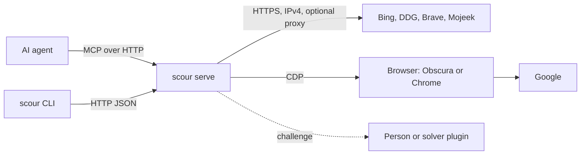

# Architecture

scour is one Rust binary. It runs as one local daemon (`scour serve`), and all the agents on the machine use it.
The daemon gets results from search engines through a cascade: it uses an HTTP client with a browser TLS
fingerprint first. It uses a real browser only for the engines that need one. It drives that browser over CDP, the
Chrome DevTools Protocol, which a program uses to control a browser. The browser runs as a separate child process.
All parts are planned.

The main reason for this shape: blocks come mostly from the IP and from the fingerprint, not from the tool. Thus
most queries use the cheap tier. A bare `axum` server measured 1.95 MB and 11.6 MiB of memory; the setup issue measures
the real binary. Only a Google query pays for a browser.

## Context

## Parts

| Part | What it does | Technology | Status |
| --- | --- | --- | --- |
| Daemon | Holds the parts below. Serves MCP and the JSON API on one port, on localhost by default. | `tokio`, `axum` | planned |
| MCP endpoint | It has one tool, `search(query, engines?)`. It returns the results, the state of each engine, and the open challenges, each with a live link for a person. | `rmcp` (streamable HTTP) | planned |
| JSON API and CLI | `GET /search` returns JSON. `scour search "q"` is a client of this API in the same binary. | `axum`, `wreq` | planned |
| Cascade | Selects the engines for a query and skips each engine that rests or is at its limit. It sends each HTTP engine through the HTTP tier, and each browser-only engine (Google) through the browser tier. It does not send a blocked HTTP engine to the browser, because a browser on a blocked IP does not help. It merges the results and removes duplicate URLs. | Rust | planned |
| Engines | One module for each engine. Each module makes the request URL and parses the page into results. The engines are Bing, DuckDuckGo, Brave and Mojeek by default. Google is browser-only and opt-in. | `scraper` | planned |
| HTTP tier | Sends requests with the TLS profile of each engine, for example Firefox for Brave. Uses IPv4 only. Sends the requests through one optional proxy (HTTP or SOCKS5), for all engines or for one engine. | `wreq`, `wreq-util` | planned |
| Browser tier | Has one function, `fetch(url) -> Page \| Challenge`. It starts the browser on the first browser query, or it connects to a CDP URL that the user gives. It stops the browser after an idle time, but not while a challenge is open. Each CDP call has a timeout. The browser uses the same proxy as the HTTP tier. Its profile is in a temporary directory that the daemon deletes when the browser stops. Its CDP port listens on `127.0.0.1` only. | `chromiumoxide` or `headless_chrome`; the browser spike selects one | planned |
| Engine state | Keeps the health of each engine (`ok`, `empty`, `blocked`, `parse_failed`), its rest timer, its rate limit with jitter, and its daily count. | Rust, in memory | planned |
| Challenge queue | Keeps each open CAPTCHA with an ID, a screenshot, a live link and an expiry time. It shows the CAPTCHA to a person through the live link, which the agent passes on, or sends it to a solver plugin. | Rust; CDP `devtoolsFrontendUrl` | planned |
| Fixtures and canary | Saved pages of each engine test the parsers. `scour canary` sends one query to each engine and prints its health. | Rust tests | planned |
| Packaging | Has two Docker images: `scour` has only the binary and the cheap engines. `scour:browser` adds the one browser that the browser spike selects, and Xvfb (a virtual display) if that browser needs one. On a Linux host without Docker, the user installs a browser and sets its path. | Docker, static musl binary | planned |

## Data

- **Search result.** This is JSON: `query`, and `results[]` with `url`, `title`, `content`, `engine` and `position`;
  `engines[]` with `name` and `state`; and `challenges[]`. The result field names are the same as in SearXNG, so
  that the format is familiar. We do not promise SearXNG compatibility, and we copy no SearXNG code (AGPL).
- **Challenge.** `{id, engine, kind, page_url, screenshot (PNG), live_url?, expires_at}`. `kind` is `recaptcha`,
  `cloudflare` or `unknown`. A person solves the CAPTCHA in the live page. Then the agent calls `search` again. The
  handoff spike can change this shape.
- **Configuration.** One TOML file, `~/.config/scour/config.toml`, and command flags. It holds the engines that are
  on, the browser command or CDP URL, the rates, the proxy, and the solver plugin command or URL.
- **State.** The daemon keeps all state in memory. A restart forgets the rest timers and the daily counts. scour
  keeps no queries and no results on disk. The browser profile is deleted when the browser stops.
- **Between the parts.** The daemon talks to the browser with CDP over WebSocket. It talks to a solver plugin with
  JSON on stdin and stdout, or with a JSON POST to an HTTP endpoint (planned for a later milestone).

## Choices

- **Rust.** `wreq-util` has current Chrome, Firefox and Safari TLS profiles in pure Rust. The measured static binary
  is 1.95 MB and uses 11.6 MiB of memory. Obscura is Rust too. We did not use Go, because its fingerprint client
  (`tls-client`) replaces `net/http` and its HTTP/2 layer has no licence file; `chromedp` is better than the Rust
  CDP clients, but the browser is a separate process in any language. We did not use Zig, because it has no library
  that gives HTTP a browser TLS fingerprint, no CDP client and no HTML parser.
- **One shared daemon.** All agents share one engine state and one rate limit. Thus two agents do not burn the same
  IP. We did not use one stdio process for each agent, because each process would count the rate limit alone.
- **The CDP client in the daemon.** Obscura and Chrome are both CDP servers. Thus a CDP endpoint is the replaceable
  boundary, and no new protocol is necessary. The handoff link comes from the same connection. That `chromiumoxide`
  can drive Obscura, and that Obscura gives a live link, are not checked yet: the browser and handoff spikes check
  them.
  - We did not use a separate `scour-browser` worker with a JSON protocol on stdin, because that protocol has only
    one user. A move to a worker later stays cheap, because all browser code is behind `fetch`.
  - We did not use the `agent-browser` CLI for each step. It starts one process for each step, and the user must
    install a second tool. It also gives less control of the fingerprint and of the live session that the handoff
    needs. A user can still connect scour to an `agent-browser` session through its CDP URL.
- **The browser as a child process, not a library.** A browser crash does not stop the daemon, and the binary stays
  small. We did not link Obscura as a library, for three reasons:
  1. V8 makes the binary approximately 70 MB, and the builds are slow.
  2. A V8 crash stops the daemon.
  3. The Rust API of Obscura v0.2.7 is not stable.

  A Cargo feature that the user turns on can add it later.
- **Cheap HTTP engines by default, Google opt-in.** Bing gave results for 8 of 8 HTTP queries in 0.31 s. Google gave
  no results to raw HTTP or to replayed browser cookies. We did not use the browser for all engines, because it costs
  approximately 100 MiB of memory and seconds for each query, as forage shows.
- **Avoid and hand off. No automatic solver in the core.** The daemon rests the engine, uses other engines and slows
  down. Then it gives the CAPTCHA to a person through a live link, or to an external solver plugin. We did not put
  a solver in the core, and we did not give the agent a `solve` tool, for four reasons:
  1. Google v. SerpApi (a DMCA 1201 case) is about automated circumvention of CAPTCHAs.
  2. A solver needs a paid account.
  3. A solver hides the blocks that the health states must show.
  4. Most models refuse to solve CAPTCHAs, and a reCAPTCHA grid needs many rounds of clicks, not one text answer.
- **One proxy, no rotation.** A user on a server with a flagged datacenter IP can send requests through a home or
  residential proxy. We did not build a rotating pool, because it needs its own health checks and it is the start
  of a scraping service.
- **Health from the parsed result count.** A page with HTTP 200 and 0 results is `empty` or `parse_failed`, not
  `ok`. We did not use the HTTP status alone, because silent empty pages stopped most earlier projects.
- **A browser only for browser-only engines.** A blocked HTTP engine rests. We did not send it to the browser,
  because the research showed that a browser on a blocked IP gets the same block.
- **IPv4 only.** IPv6 breaks DDG, Brave, Mojeek, Startpage and Qwant (SearXNG #6833).
- **State in memory.** This is the smallest store that works for one daemon. We did not use SQLite or a file. Add
  one if restarts reset the daily limits too often.
- **The CLI uses the JSON API, not an MCP client.** `curl` and SearXNG clients can use the same endpoint. The CLI
  needs no MCP session. We did not use an MCP client in the CLI, because it adds a session for one call.
- **Two Docker images.** Users who do not need Google do not download a browser. We did not use one image, because
  a browser makes it hundreds of MB larger. `scour:browser` has one browser, not two.

## Unknowns

The technical questions that are open are in "Open questions" in `docs/vision.md`, each with its spike.
