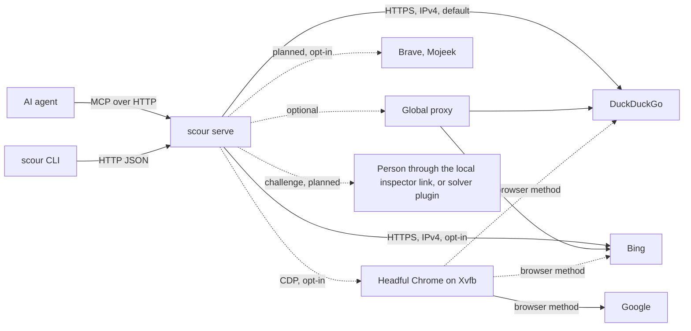

# Architecture

scour is one Rust binary. It runs as one local daemon (`scour serve`), and the agents on the machine use it.
The daemon asks DuckDuckGo by default. A person can turn on Bing, and Google with `--browser`. It uses an HTTP
client that has a browser TLS fingerprint. It listens only on `127.0.0.1:7268`. No flag, variable or file changes that address.
An agent searches through MCP over streamable HTTP at `/mcp`.
With `--browser`, the daemon runs headful Chrome on Xvfb, a virtual display.
The daemon drives Chrome through CDP (the Chrome DevTools Protocol) with `chromiumoxide`.

The main reason for this shape: blocks come mostly from the IP and from the fingerprint, not from the tool. Thus
most queries use the cheap tier. The release binary is 17657880 bytes. The idle daemon uses 11.0 MiB of memory.
The browser tier runs queries for engines set to `browser` in the config or query. Google uses the browser tier.

## Context



## Parts

| Part | What it does | Technology | Status |
| --- | --- | --- | --- |
| Daemon | Serves the JSON API and MCP on `127.0.0.1:7268` only. One layer rejects every request with a foreign `Host` or `Origin`. | `tokio`, `axum` | built |
| MCP endpoint | Serves streamable HTTP at `/mcp`. It has one tool, `search(query, engines?)`. The answer carries the `GET /search` JSON as `structuredContent`, the `scour search` text as `content[0].text`, and `isError` when no engine is `ok` or `empty`. The optional `engines` list selects the engines and the method of each engine for one query (refer to "Data → Search result"). The tool description warns that titles and snippets are untrusted web text. Planned: the answer shows the open challenges. | `rmcp` (streamable HTTP, stateless JSON) | built |
| JSON API and CLI | `scour search "q"` uses `GET /search`. `scour status` uses `GET /status` to read engine health without sending an engine request. `GET /search` accepts the same `engines` list as MCP, and `scour search --engines duckduckgo,bing@http "q"` sends it. | `axum`, `wreq` | built |
| Parallel search | Starts one task per selected engine in a `JoinSet`. Each task checks its engine's limits before it sends a request. Search reports every engine state in config order and merges the results round-robin. | `tokio` | built |
| Cascade | Selects the engines and the method of each engine for a query. The engines come from the query `engines` list, or else from all enabled engines. The method of each engine comes from the query, or else from the config. It checks the whole list before it sends any engine request. The cascade sends `browser` engines through the browser tier when `--browser` is set. It never changes the method of an engine after a block, because a browser on the same IP gets the same block. | Rust | built |
| Engines | Each engine makes the request URL and parses the page. One `Engine` struct holds the name, base URL, profile, supported methods, URL builder and page reader. Each engine is one file with the same shape. There is no `Engine` trait, because a function pointer is enough for the engines. DuckDuckGo is built as the only default engine. It uses `https://html.duckduckgo.com/html/?q=<q>&kl=us-en`, and it reads the target URL from the `uddg=` parameter of each `/l/` redirect link. Bing is built as an opt-in engine. Brave and Mojeek are planned as opt-in engines. Brave gave 7 good answers, then HTTP 429 on paced query 5, so it may need the browser tier. Mojeek has no saved result page. Google is built as a browser-only engine. It uses `https://www.google.com/search?q=<q>&hl=en&pws=0`. A web result URL is the absolute Google `/goto?url=` redirect, because the result page gives no free target URL. A `/url?q=<target>` link uses the plain target, because it costs no extra request. A video card uses its exact `data-curl` URL when that is an http(s) URL on another site. Each result has a `domain` from the host in `<cite>`, and the field is absent when `<cite>` shows only a date or a count. The `/sorry/` page gives `blocked`, and changed result markup gives `parse_failed`. Both methods use the same `request_url` and `read`. The browser method reads the DOM after the page loads. Planned: `profile` becomes optional for browser-only engines, and `read` can give `Page::Challenge(kind)`. `duckduckgo::read` gave `ok` on 3 of 3 pages from headful Chrome (#31). `bing::read` gives `Page::Challenge(cloudflare)` when the CSS selector `#turnstile-widget` matches. That selector was on 4 of 4 Turnstile pages and on 0 of more than 70 other Bing pages (#31). The current `bing::read` gives `empty` on a Turnstile page. A check for the `challenges.cloudflare.com` host is not a marker, because Bing result pages also load it. Not built: a step that opens the home page and types the query, as `openserp` does for Bing. Spike #31 did not test it. | `scraper` | built for DuckDuckGo, Bing and Google |
| HTTP tier | Sends the DuckDuckGo and Bing requests with the Chrome TLS profile. Uses IPv4 addresses for hosts it resolves locally. Supports one optional proxy for all engine requests. Google has no HTTP method. | `wreq`, `wreq-util` | built for DuckDuckGo and Bing |
| Browser tier | Starts one Chrome on Xvfb on the first browser query. Every Chrome request uses one command-line proxy: the config proxy, or a local SOCKS5 forwarder that allows IPv4 only. `fetch(url)` opens a tab in one shared query context, reads the main document status and rendered HTML, then closes the tab. The CDP port is fixed at `127.0.0.1:7269`. See "Browser lifecycle" below. | `chromiumoxide` 0.9 | built |
| Engine state | Each engine tracks its last state, block rest, pace tokens and rolling 24-hour request count. Both methods of an engine share this state. | Rust, in memory | built for DuckDuckGo, Bing and Google |
| Challenge queue | Keeps each open CAPTCHA with an ID, a screenshot, a live link and an expiry time. One queue serves every `browser` engine: a Google reCAPTCHA and a Bing Turnstile are both challenges. An engine has at most one open challenge, because the challenge starts a rest and the resting engine opens no tab. The live link is the local Chrome inspector of the challenge tab. The agent passes it to a person. A solver plugin is planned for after the first release. The queue watches the tab for the done signal (refer to "Data"). It removes the challenge on the done signal or at expiry. | Rust; CDP target list | planned |
| Fixtures and canary | Saved DuckDuckGo, Bing and Google pages test the parsers. The Google fixtures are `fixtures/google/results.html` (the #15 page from more than 3 hours after a solve, 8 results), `web-results.html` (the #37 page, 10 results) and `sorry.html`. Planned: `scour canary` sends one query to each engine and prints its health. Also planned: the headful Bing result and Turnstile pages from spike #31 (`fixture-bing-results.html`, `fixture-bing-turnstile.html`). The #31 saver removed inline `<script>` text, so the Turnstile marker test also uses an unchanged #14 result page (`bing-bing-headful-01.html`). | Rust tests | built for DuckDuckGo, Bing and Google |
| Packaging | The `scour` image runs the HTTP engines and is about 138 MB on x86_64 and 159 MB on arm64. The planned `scour:browser` image adds Chromium and Xvfb. The installed Chromium of the browser spike is 437 MB. On Linux, install Chrome or Chromium and Xvfb. scour runs `Xvfb` from `PATH`. For Chrome, it checks `CHROME`, then `chrome`, `chrome-browser`, `google-chrome-stable`, `chromium` and `chromium-browser` on `PATH`, in order. | Docker, static musl binary | `scour` built for x86_64 and arm64, `scour:browser` planned |

## Browser lifecycle

- The browser root is `/dev/shm/scour-<uid>`, a memory-backed directory with mode `0700`.
  The daemon binds `127.0.0.1:7268` first. Then it locks the root with `flock` and only the lock holder deletes
  left-over entries. The kernel frees the lock at any death, including `kill -9`.
  Start-up cleanup removes each run directory from a dead daemon and each `/tmp/.X<n>-lock` whose content is that
  daemon's PID. It never removes an X socket or another process's X lock. The root must be a real directory of
  this user, because the cleanup deletes every entry.
- A run directory is `<root>/<pid>-<nanos>/`. It holds `display`, `profile/` and `tmp/`. The short path leaves
  room for Chrome's process-singleton socket under the kernel's Unix socket limit.
- The daemon chooses an X display that has neither a file socket nor a Linux abstract socket.
  It reserves the display with `/tmp/.X<n>-lock`. Xvfb uses `-displayfd` to report readiness.
- The daemon reads the CDP WebSocket URL from Chrome's stderr and discards the rest of stderr.
  Chrome must announce the fixed endpoint at `127.0.0.1:7269`.
  Omitting `--remote-allow-origins` keeps Chrome's default Origin checks.
- Query tabs share one CDP browser context. Its cache, history, cookies and storage stay in memory.
  Chrome starts with a temporary profile and a blank tab. Its `TMPDIR` is inside the run directory.
- One supervisor task for each Chrome session ends the session when Chrome exits or when
  `[browser] idle_seconds` passes without a query. The default is 5400 seconds (90 minutes); the range is
  1 to 86400. A query that holds the CDP client makes the session busy, so the supervisor checks again later.
  The deferred check stays in the supervisor's `select!`, so a Chrome crash still ends the session at once.
  The run directory and profile go away on both paths.
- A query that reuses a running session and loses CDP while it opens its page ends that session and starts
  one new session. An error on the new session, or any error after navigation starts, is final.
- `Group::spawn` sets `PR_SET_PDEATHSIG` in `pre_exec`. Chrome gets SIGKILL and Xvfb gets SIGTERM when the daemon
  dies. The signal fires when the spawning thread exits, so the daemon spawns children only on the runtime thread;
  `main` keeps the `current_thread` runtime.
- Ctrl-C, SIGTERM, server errors and failed starts release the resources the daemon acquired.
  The daemon kills Chrome's process group, deletes the run directory, stops Xvfb with SIGTERM, and releases the lock.
  It sends SIGKILL if Xvfb takes more than five seconds to stop. A teardown keeps the state lock until the old
  session is gone, so a new start never overlaps it.
- Tab limits and a user-supplied CDP URL are planned.

### Browser proxy

- Chrome gets one `--proxy-server` on its command line. With `proxy` set, it is the config proxy, and
  `socks5h://` becomes `socks5://`. Without `proxy`, it is a local SOCKS5 forwarder on `127.0.0.1:0`.
  The forwarder starts with the session and stops with it.
- The command line covers the query context and browser-wide services. A per-context
  `CreateBrowserContext` proxy covers only the query context, so background requests would still go direct.
  We use Chrome's own proxy code and not a chained forwarder to the config proxy. A chained forwarder would
  add about 100 lines of proxy-client code. It would turn plain HTTP targets into `CONNECT` tunnels that many
  proxies refuse off port 443. It would also report a stopped proxy as a forwarder SOCKS error.
- `--proxy-bypass-list=<-loopback>` sends loopback targets through the proxy too. Chrome still reaches the
  proxy or forwarder at `127.0.0.1`.
- `--host-resolver-rules=MAP * ~NOTFOUND , EXCLUDE 127.0.0.1` stops every other name from resolving in
  Chrome. With a proxy on another host, the rule also excludes that host. Without the exclusion, a proxy
  given by name cannot resolve. A request that skips the proxy cannot connect.
- Chrome rejects `socks5h://` with `ERR_NO_SUPPORTED_PROXIES`. Its `socks5://` sends the host name to the
  proxy, so scour passes `socks5h://` as `socks5://`. The proxy resolves the engine host name.
- A proxy with a user name or a password stops `--browser` with exit code 1. The message has no part of
  the URL. The same config starts without `--browser`.
- `--disable-background-networking` does not stop every background request to Google. These switches do:

| Service | Request | Switch |
| --- | --- | --- |
| Sign-in cookie check | `accounts.google.com/ListAccounts` | enable `SkipListAccountsWithoutGaiaCookies` |
| AI Mode eligibility | `www.google.com/async/folae` | disable `AimEnabled` |
| Optimization Guide models | `optimizationguide-pa.googleapis.com/v1:GetModels` | disable `OptimizationHints` |
| Network time | `clients2.google.com/time/1/current` | disable `NetworkTimeServiceQuerying` |
| Safe Browsing real-time lookup key | `www.gstatic.com/ohttp_gateway/hpke_public_keys/v1/sbc_prod` | disable `SafeBrowsingHashPrefixRealTimeLookups` |
| Preconnect to the default search engine | `https://www.google.com/` | disable `PreconnectToSearch` and `SearchEnginePreconnect2` |

- The forwarder accepts only `CONNECT`. It resolves a name with `tokio::net::lookup_host` and keeps the
  first IPv4 address. An IPv4 literal connects as given. A name with no IPv4 address gets reply 4, and an
  IPv6 literal gets reply 8. The accept task owns the connection tasks in a `JoinSet`, so stopping the
  session closes every relay. The forwarder listens on `127.0.0.1` only, on a temporary port.
- A failed forwarder bind stops the start with `cannot start the IPv4 forwarder: {err}` and cleans the run
  directory.
- A browser page error gives one of these messages:
  - A configured proxy refused the connection (`ERR_PROXY_CONNECTION_FAILED`):
    `cannot connect to the proxy`.
  - A proxy that cannot reach the host: `the proxy cannot connect to {host}`.
  - No proxy, and no IPv4 address or a failed IPv4 connection: `cannot connect to {host} over IPv4`.
    Chrome gives `ERR_SOCKS_CONNECTION_FAILED` for every forwarder reply code.
  - Other errors, such as a bad certificate: `cannot connect to {host}`.

## Data

- **Search result.** `GET /search?q=<text>` returns JSON. It has `query`, `results[]` with `url`, `title`,
  `content`, an optional `domain`, `engine` and `position`, and `engines[]` with `name`, `method`, `state`,
  `daily_count` and `daily_limit`. A Google result has `domain` when `<cite>` shows a host; the field is absent
  otherwise.
  The merge takes one item per engine in config order for each rank. It keeps the first occurrence of each exact
  URL string, including that item's engine, and assigns consecutive positions starting at 1.
  The `engines[]` array stays in config order even when engine tasks finish out of order.
  `method` is `http` or `browser`, as used by the query.
  `engines[].error` is present only when the state is `error`. `engines[].ready_at` is present for `blocked`
  and `limited`. It is an RFC 3339 UTC
  timestamp to the second. A missing `q`, or a query of only spaces, returns HTTP 400. `challenges[]` is
  planned. The field names are the same as in SearXNG, so the format is familiar. We do not promise SearXNG
  compatibility, and we copy no SearXNG code (AGPL). The API ignores other parameters, so a client that sends
  `format=json` still works.
  - An optional `engines` list selects the engines for one query: `engines=duckduckgo,bing@http` in
    `GET /search`, or `"engines": ["duckduckgo", "bing@http"]` in MCP. `engines=` with nothing after it is
    the empty list. Each item is `<name>` or `<name>@<method>`. A bare name uses the method from the config.
  - An item can name only an engine that the config enables. A person turns engines on; an agent does not.
  - A bad list stops the whole query with HTTP 400 (MCP `isError: true`), and no engine request goes out.
    The message names the item. Bad items are:
    1. An unknown name, an engine that is not enabled, a duplicate name, or an empty list.
    2. An unknown method, or a method that the engine does not support, for example `google@http`.
    3. An `@browser` item when the browser tier is off, for example
       `duckduckgo@browser needs the browser; start scour serve with --browser`.
- **Engine state.** HTTP 403 and 429 give `blocked` for any engine. For other statuses, the page reader can
  identify a block from the body. DuckDuckGo challenge pages give `blocked` at any status. Any remaining
  non-200 response gives `error` with `HTTP <n>`. Network failures and timeouts also give `error`.
  On HTTP 200, parsed results give `ok`. A DuckDuckGo no-results marker gives `empty`. Unrecognized
  DuckDuckGo pages give `parse_failed`. Bing reports `empty` when its parser finds no results on HTTP 200.
  Google pages without a challenge or results give `parse_failed`.
  The CLI prints results and `ok` or `empty` summaries to stdout. It prints `blocked`, `limited`, `parse_failed`
  and `error` to stderr. Each summary line starts with `name@method`, for example `duckduckgo@http: ok`.
  If no engine returns `ok` or `empty`, stdout is empty and the CLI exits with code 1.
  Both methods use the same states. For `browser`, the HTTP status comes from the tab's main document.
  Planned: a `Page::Challenge` gives `blocked`, starts the rest, and opens a challenge.
- **Rest.** The first block starts a 10-minute rest by default. Each consecutive block doubles that duration, up to 4 hours.
  An `ok` response clears rest and resets the count. An `empty`, `parse_failed` or `error` response leaves both unchanged.
  A monotonic clock controls when the next request can go out. The daemon stores a wall-clock deadline for each rest window.
  Searches during that window skip the request and return `blocked` with the same `ready_at`.
  The CLI and MCP round the remaining time up to seconds.
  If the rounded time is 60 seconds or more, they show it in minutes rounded up.
- **Request limits.** Each engine HTTP request has a 10-second timeout and a limit of 10 redirects.
  The CLI waits up to 45 seconds for a response from the daemon.
  A browser page has a 10-second timeout. The first query also allows 30 seconds each for Xvfb and Chrome to start,
  because a cold CI start took more than 10 seconds.
  Planned: a total browser budget (#44) that includes the wait for a free tab. A timeout gives `error`.
- **Pace and daily limits.** Admission checks active rest first, then the rolling daily limit, then pace.
  By default, each engine starts with three tokens and refills one every 120 seconds, up to three.
  Each engine defaults to 100 requests per 24 hours. The `[limits]` keys `burst`, `refill_seconds` and `daily`
  set the same values for every enabled engine. Duration keys use positive whole numbers and end in their unit.
  If the next token is more than 30 seconds or one refill interval away, the engine reports `limited` with `ready_at`.
  The 30-second cap and the 10-second engine timeout fit within the CLI's 45-second wait.
  Otherwise, admission reserves the token and adds the request to the daily count. It releases the lock before any wait.
  If rest begins during the wait, the daemon cancels the send and refunds its daily reservation.
  Failed sends count. At the daily limit, `ready_at` is the oldest request's admission time plus 24 hours.
  After a paced run of 60 queries, DuckDuckGo blocked the test IP for more than 12 hours.
  The research estimate was 50 to 100 queries per day from one IP. [Spike #14](https://github.com/shantanugoel/scour/issues/14) and [follow-up #35](https://github.com/shantanugoel/scour/issues/35).
  `http` and `browser` requests of one engine use the same tokens and the same daily count.
- **Status.** `GET /status` returns `engines[]` in config order, with `name`, `last_state`, `daily_count` and `daily_limit`.
  `last_state` starts as `null` and tracks search outcomes, including requests skipped during rest or at a limit.
  `ready_at` appears during active rest, at the daily limit, or if a pace wait exceeds 30 seconds or one refill interval.
  `scour status` prints this snapshot, which sends no engine requests.
  The snapshot has one row for each engine, because both methods share one state.
- **MCP answer.** `POST /mcp` carries one JSON-RPC message. A request needs `Content-Type: application/json` and
  `Accept: application/json, text/event-stream`. The server keeps no session: each request stands alone, and the
  answer is one JSON body, not an SSE stream. `tools/list` returns one tool, `search`, with the object argument
  `{query: string, engines?: string[]}`. `required` is `["query"]`.
  For a search answer, `tools/call` returns the `GET /search` JSON in `structuredContent` and
  the `scour search` text in `content[0].text`. A blank query or a bad `engines` list sets `isError: true` and
  returns only the error message in `content[0].text`. A search answer sets `isError: true` when no engine is
  `ok` or `empty`. A blank query or a bad list sends no engine request. The server reports `serverInfo` as `scour`.
- **Local-only guard.** One `Router::layer` wraps every route, including `/mcp`, `/search`, `/status` and unknown paths. A
  request requires one `Host` header with `127.0.0.1[:port]` or `localhost[:port]`. An optional `Origin` header
  must appear at most once and use `http://127.0.0.1[:port]` or `http://localhost[:port]`. Each optional port
  must contain only digits and have a value from 0 to 65535. Any other request gets HTTP 403 with
  `{"error":"the Host or Origin is not local"}`. The guard stops a web page from reaching the daemon through a
  name that points at `127.0.0.1` (DNS rebinding). `rmcp` also checks the `Host` by default; our layer runs first
  and answers in the same way on every route.
- **Challenge.** This shape is planned: `{id, engine, kind, page_url, live_url, expires_at}`. A screenshot is not in the shape, because only a solver plugin would use it.
  `kind` is `recaptcha`, `cloudflare` or `unknown`. A Bing Turnstile challenge has the kind `cloudflare`.
  - `live_url` is the local Chrome inspector of the challenge tab:
    `http://127.0.0.1:<port>/devtools/inspector.html?ws=127.0.0.1:<port>/devtools/page/<id>`. `<port>` is the CDP
    port, and `<id>` is the CDP target ID of the tab.
  - A person on another computer opens the link through `ssh -L <port>:127.0.0.1:<port> <host>`. The port number
    must be the same on both ends, because the link contains it.
  - An open reCAPTCHA widget expired approximately 2 minutes after a click, on a demo page. How long an unclicked
    Google `/sorry/` page stays solvable is not measured. Milestone 2 sets `expires_at` from a measurement.
  - The done signal for Google is the `GOOGLE_ABUSE_EXEMPTION` cookie, or a Google `/search` result page in the
    tab, at the solve. The cookie expired 2h55m after the solve in spike #15, and the session still gave results,
    so the cookie is not a sign of the session life. A URL that is no longer `/sorry/` is not enough,
    because the tab can go to a wrong page.
  - For another engine, the done signal is a page in the tab that the engine `read` gives as results or `empty`.
    For Bing, the owner cleared Turnstile through the live link in 10 s (#31). The widget left the page, the tab
    URL stayed `/search?q=...`, and `bing::read` gave results. Bing set no Cloudflare cookie, so `expires_at` of a
    Bing challenge has no cookie to come from. Milestone 2 sets it.
  - After the done signal, the challenge leaves `challenges[]`, and the rest of that engine ends. The agent calls
    `search` again, and the browser session gives results.
- **Configuration.** One TOML file holds the enabled engines. The default path is `$XDG_CONFIG_HOME/scour/config.toml`,
  or `$HOME/.config/scour/config.toml`. The `engines` key is a list; it defaults to `["duckduckgo"]`, and a person
  can add `bing`, and `google` with the browser. `scour serve --config <path>` reads another file. Invalid TOML stops the daemon with exit code 1.
  An item is `<name>` or `<name>@<method>`, as in `["duckduckgo", "bing@http"]`. A bare name uses the engine
  default: `http` for DuckDuckGo and Bing, and `browser` for Google.
  An unknown engine, unknown method or duplicate name stops startup with exit code 1.
  `["bing", "bing@http"]` is a duplicate. An item that needs the browser requires `scour serve --browser`.
  Google is a browser-only engine, so `google@http` is a bad item.
  `[testing.base_urls]` applies to both methods.
  The same exit code applies to an unknown key, an empty list, or a missing `--config` file. A TOML error shows a
  redacted parser message and the line number.
  The optional `proxy` key applies to HTTP queries and, with `--browser`, to all Chrome traffic. It accepts
  an HTTP, SOCKS5, or SOCKS5H URL. The URL has no path, query, or fragment, apart from a bare trailing `/`.
  An invalid proxy URL stops startup with exit code 1. The start line shows only the proxy scheme, host and port.
  An unencoded `#`, `?`, or `/` in the password stops startup with a message to percent-encode the password.
  That message omits the URL. With `--browser`, a user name or a password in the URL stops startup with
  exit code 1 and a fixed message that has no part of the URL.
  Failed proxy connections return `error`. The engine client and Chrome make no direct fallback request.
  The optional `[limits]` table applies to all enabled engines. Each omitted key keeps its default.

  ```toml
  [limits]
  burst = 3
  refill_seconds = 120
  daily = 100
  ```

  The inclusive ranges are 1 to 1000 for `burst`, 1 to 86400 for `refill_seconds`, and 1 to 4294967295 for `daily`.
  An invalid value stops startup with exit code 1 and a message that names the key and omits the value.
  Unknown keys and engine subtables also stop startup with exit code 1.
  The optional `[browser] idle_seconds` key sets the Chrome idle stop. It is a whole number of seconds from 1 to
  86400, and the default is 5400 (90 minutes). The key loads with or without `--browser`.
  For local tests, `[testing].rest_seconds` sets a positive base duration.
  `[testing.base_urls]` maps enabled engine names to HTTP or HTTPS URLs. Unknown and disabled engine keys fail at startup.
  The listen address stays fixed at `127.0.0.1:7268`. In Docker, `socat` listens on each non-loopback container IPv4
  address on port 7268 and forwards TCP bytes to the daemon. The daemon checks the original `Host` and `Origin` headers.
  The image runs as user `scour` (UID 10001), with `/home/scour/.config/scour/config.toml` as the default config path.
- **State.** The daemon writes no query and no result to disk. It prints one start line and no query. It installs
  no `tracing` subscriber, so a library log call cannot print a query. Engine limits and health live in memory.
  Each engine has its own mutex. The code releases it before any wait or network request.
  The daemon deletes the temporary browser profile when Chrome stops. The planned Google solve keeps the
  session in the query context's memory, so a browser stop ends it. The session is more than the
  `GOOGLE_ABUSE_EXEMPTION` cookie: in spike #15, Google kept giving results for 5 hours after that cookie expired.
- **Between the parts.** The CLI talks to the daemon directly with HTTP JSON and bypasses all proxies.
  The daemon drives Chrome over a WebSocket on `127.0.0.1:7269`. The planned solver plugin would use JSON
  on stdin and stdout, or a JSON POST.

## Choices

- **Rust.** `wreq-util` has current Chrome, Firefox and Safari TLS profiles in pure Rust. The release binary is
  17657880 bytes and the idle daemon uses 11.0 MiB of memory. A static musl build with `wreq` works: the engine
  spike binary was 8.2 MB, with a peak of 28.8 MiB. We did not use Go, because its fingerprint client
  (`tls-client`) replaces `net/http` and its HTTP/2 layer has no licence file; `chromedp` is better than the Rust
  CDP clients, but the browser is a separate process in any language. We did not use Zig, because it has no library
  that gives HTTP a browser TLS fingerprint, no CDP client and no HTML parser.
- **One shared daemon.** All agents share one engine state and one rate limit. Thus two agents do not burn the same
  IP. We did not use one stdio process for each agent, because each process would count the rate limit alone.
- **DuckDuckGo as the only default engine.** In a paced 60-minute run from the home IP, cookie-free DuckDuckGo
  answered 60 of 60 queries, with no home-page visit and no cookie jar. 58% of its results matched all query words.
  Bing answered each query, but in the 24 plain HTTP variants only 0 of 238 results matched all query words.
  Headful Chrome matched 58% on 2 of 3 queries, so the client causes the mismatch. Brave gave HTTP 429 with a
  CAPTCHA, Mojeek gave HTTP 403, and Startpage, Qwant, Yahoo and Ecosia gave no results. We did not keep Bing as a
  default, because a result that does not match the query is worse than no result: the agent cannot see the
  difference. When the only enabled engine reports a block, the answer has no results. Pace and daily limits
  reduce the chance of a block.
- **The CDP client in the daemon.** `chromiumoxide` drove all steps of a Google search in the spikes.
  The planned handoff link uses the same CDP server.
  - The daemon spawns and reaps its own process groups. Chrome's stderr identifies its own CDP endpoint on a
    fixed or ephemeral port. If Chrome falls back to `[::1]`, the daemon rejects the endpoint and stops Chrome.
  - A CDP browser context keeps query data off disk and preserves cookies between tabs. With `--incognito`,
    CDP still creates tabs in the disk-backed default context. Cache flags leave history and other files on disk.
  - The daemon owns the X lock because `-displayfd` turns off Xvfb's lock. It checks abstract sockets on the
    host because Docker's network namespace hides them from the test Xvfb.
  - The run directory is under `/dev/shm/scour-<uid>`, and Chrome's private `TMPDIR` is inside it. This keeps the
    process-singleton socket path short and lets the run-directory guard clean up its
    `org.chromium.Chromium.*` directory after SIGKILL.
  - Chrome uses `--password-store=basic` and `--use-mock-keychain` because Chromium can hang on the system keyring.
  - We did not use a separate `scour-browser` worker with a JSON protocol on stdin, because that protocol has only
    one user. A move to a worker later stays cheap, because all browser code is behind `fetch`.
  - We did not use the `agent-browser` CLI for each step. It starts one process for each step, and the user must
    install a second tool. It also gives less control of the fingerprint and of the live session that the handoff
    needs. A user-supplied CDP URL is planned.
- **Headful Chrome on Xvfb.** It was the only browser that got parsed Google results from the home IP (2 of 2 in the
  last session; the first session got 2 reCAPTCHA pages). Obscura 0.2.7, Scrapling and headless Chrome each got
  reCAPTCHA pages (0 of 2). The first headful session also failed, so a short IP block during those rows is possible. We did not use Obscura, because it got no Google results, it has no library crate on
  crates.io, and its stealth build is 164 MB. We did not use headless Chrome, because Google blocked it. Headful
  Chrome also cleared a Cloudflare challenge on its second load. That test was not fair to the other browsers.
- **The browser as a child process, not a library.** A browser crash does not stop the daemon, and the binary stays
  small. Chrome is not available as a library. We did not link a V8 browser such as Obscura, because V8 makes the
  binary approximately 70 MB, a V8 crash stops the daemon, and Obscura got no Google results.
- **One locked browser root for each user.** The root is `/dev/shm/scour-<uid>`, and the daemon takes a `flock`
  on it after the bind. This gives three results. (1) The kernel frees the lock at any death, so a new daemon
  can clean after `kill -9`. (2) `/dev/shm` is tmpfs on systemd hosts and in Docker; `/tmp` is not always.
  (3) The root must be a real directory of this user, because the cleanup deletes every entry. The daemon opens
  it with `O_DIRECTORY | O_NOFOLLOW`, checks its owner with `fstat`, and reads and removes entries through the
  locked descriptor, so a swapped path cannot redirect the cleanup.
- **A teardown completes before a new session starts.** (1) `PR_SET_PDEATHSIG` fires when the spawning thread
  exits, so children start only on the runtime thread. (2) `end` drops the old session under the lock, so a query
  waits for a teardown and does not overlap it. (3) The Docker shim's watcher outlives `stop`, so it can remove
  a container that an in-flight create adds.
- **Cheap HTTP engines by default, Google opt-in.** DuckDuckGo answered each paced query in a median time of
  approximately 0.7 s. Google gave no results to raw HTTP or to replayed browser cookies. We did not use the browser
  for all engines, because headful Chrome on Xvfb used a peak PSS of 696 MiB and an idle PSS of 551 MiB (#32),
  and 3 to 11 s for each Google query in the spikes. In 8 hours of hourly Google searches (#15), Chrome used a peak
  PSS of 731 MiB (761 MiB with Xvfb) and an idle PSS of 533 MiB. PSS (proportional set size) counts each shared
  page one time. The 1.7 to 2.0 GiB of the browser spike was a sum of `VmRSS`, which counts shared pages one time
  for each process. That sum is about 2 times the peak PSS.
- **Avoid and hand off. No automatic solver in the core.** The daemon rests the engine, uses other engines and slows
  down. Then it gives the CAPTCHA to a person through a live link. An external solver plugin is planned for after the
  first release. We did not put
  a solver in the core, and we did not give the agent a `solve` tool, for four reasons:
  1. Google v. SerpApi (a DMCA 1201 case) is about automated circumvention of CAPTCHAs.
  2. A solver needs a paid account.
  3. A solver hides the blocks that the health states must show.
  4. Most models refuse to solve CAPTCHAs, and a reCAPTCHA grid needs many rounds of clicks, not one text answer.
- **The local Chrome inspector as the live link.** The owner solved a Google reCAPTCHA through it in 26 s, from
  another computer through an SSH tunnel. The same session then gave Google results on 5 of 5 searches. The link
  gives full control of the browser (`Runtime.evaluate`, `Network.getCookies`, `Page.navigate`), so it stays on
  `127.0.0.1`. A person on another computer uses an SSH tunnel.
  - We did not use the appspot `devtoolsFrontendUrl` that Chrome gives, because its socket closes and the page does
    not show.
  - We did not build a screencast page in the daemon. The inspector is sufficient, and a screencast page that
    connects to the CDP socket gives the same full control.
- **The done signal from the cookie or the result page.** The `GOOGLE_ABUSE_EXEMPTION` cookie and a Google `/search`
  result page show that Google accepted the solve. We did not use "the URL left `/sorry/`" alone, because a person
  can move the tab to a wrong page, and that would look like a solve.
- **One proxy, no rotation.** A user on a server with a flagged datacenter IP can send requests through a home or
  residential proxy. We did not build a rotating pool, because it needs its own health checks and it is the start
  of a scraping service.
- **Health from the response status and body.** A DuckDuckGo challenge can arrive with HTTP 200 or 202.
  The explicit no-results marker lets the DuckDuckGo reader report `parse_failed` when result markup changes.
- **The method of each engine comes from the config or the query.** The config sets the default method.
  An agent can set `@http` or `@browser` for one query. Google is a browser-only engine, so a bare `google`
  item uses the browser method.
  - Reason: Bing over plain HTTP gave 0 of 238 matching results, and Google has no `http` method. A person can
    send an engine through the browser when its HTTP answers are bad. In headful Chrome, Bing was not stable:
    spike #31 got Turnstile and then off-topic results, and spike #32 got results on 6 of 6 queries.
  - The browser is not the default, because headful Chrome used a peak PSS of 696 to 731 MiB (#32, #15) and 3 to
    11 s for each query.
  - We did not switch an engine from HTTP to the browser after a block. A browser on the same IP gets the same
    block, and the switch would spend the engine's budget two times.
  - We did not switch on a mismatch either. Bing returns HTTP 200 with unrelated results, so scour cannot see
    the mismatch.
- **One state for both methods of an engine.** Rest, pace and the daily count are for each engine,
  not for each engine and method. A Bing HTTP block and a Bing browser block come from the same IP and the same
  Bing limits.
  - We did not keep a state for each method. With it, `bing@browser` could go around a Bing rest. That is the
    same as the rejected automatic switch, done by hand.
- **`name@method` items.** One flat list of strings is the same in the config, `GET /search` and MCP.
  The name `engines` and the comma list in `GET /search` follow SearXNG. `@` cannot occur in an engine name.
  - We did not use objects such as `{name, method}`, because they make the list longer for each agent call.
  - A bad item stops the whole query, and no engine request goes out. We did not report it as an engine `error`.
    That would mix a caller mistake with engine health and change `last_state`.
- **No OpenCode `browse` as the browser.** It drives the person's own signed-in browser through an extension. scour
  needs a separate browser with a temporary profile, so agent searches never use the person's Google or Bing
  account. It also needs an extension, a pairing step and a second tool. Its way to stay hidden is worth copying if
  Google detects `chromiumoxide`: it turns on no CDP domain that a page can detect, and runs its code in isolated
  worlds.
- **No Ardia as the browser.** Ardia is a Chromium fork with a Unix control socket. The goal was a browser with no
  CDP port. In spike #32, Ardia 0.2.49 turned off its control socket when its token server could not bind TCP. So
  the socket does not remove a port. Its search results and memory were not measured. Chrome stays, and a person can
  connect another browser through a CDP URL when that feature is built.
- **IPv4 for local DNS.** IPv6 breaks DDG, Brave, Mojeek, Startpage and Qwant (SearXNG #6833).
  Direct HTTP engine connections and `socks5://` use the local IPv4-only resolver.
  With `http://` and `socks5h://`, the proxy resolves engine hostnames and chooses IPv4 or IPv6.
  The browser tier keeps the same IPv4 rule. Without a proxy, Chrome reaches engines through the local
  SOCKS5 forwarder, which keeps only IPv4 addresses.
- **State in memory.** This is the smallest store that works for one daemon. We did not use SQLite or a file. Add
  one if restarts reset the daily limits too often.
- **The CLI uses the JSON API, not an MCP client.** `curl` and SearXNG clients can use the same endpoint. The CLI
  needs no MCP session. We did not use an MCP client in the CLI, because it adds a session for one call.
- **A stateless MCP server with no session ID.** The daemon holds no per-client MCP state, and every request is one
  JSON body with one answer. The CLI, a plain JSON-RPC script, and an agent use the same daemon, and a restart
  loses nothing that a client must renew. We did not use `legacy_session_mode`, because a session ID adds a
  handshake and a session table for a tool that holds no conversation state. If a client needs sessions, turn that
  mode on and record why.
- **Two Docker images.** Users who do not need Google do not download a browser. We did not use one image, because
  Chrome makes it several hundred MB larger: the installed Chromium is 437 MB. `scour:browser` has one browser,
  not two.
- **Docker packaging.** The plain image contains the HTTP engines. The browser image is planned.
  1. **Container IPv4 addresses.** A forwarder on `0.0.0.0:7268` conflicts with the daemon on `127.0.0.1:7268`.
     `socat` binds to the non-loopback IPv4 addresses from `hostname -i`. On a single bridge, `/proc/net/tcp` shows
     the daemon and one forwarder. A Rust forwarding command would put a configurable non-loopback listener in
     every build.
  2. **Tini.** As PID 1, `scour` would ignore SIGTERM. Tini forwards SIGTERM to the daemon and reaps orphaned
     children. A shell trap does not reliably reap orphans. The planned browser image also needs this for Chrome and
     Xvfb. Tini is built into the image so the run command needs no `--init` flag.
  3. **Debian slim.** The planned browser image can install Debian Chromium and Xvfb, as in spikes #15 and #37.
     The Debian base is about 116 MB, compared with about 14 MB for Alpine. The binary uses CA roots from
     `webpki-roots` through `wreq`.
  4. **Zig.** BoringSSL (`btls-sys` 0.5.6) needs `cmake`, `git`, `libclang` and a C++ standard library.
     Debian's `musl-tools` supplies no musl C++ toolchain. The Alpine musl Rust image could not load `libclang`
     in spike #1. Zig supplies the musl C and C++ toolchains used to build the static x86_64 and aarch64 binaries.
  5. **Static build check.** The Zig build produces a static binary of about 12.9 MB on x86_64 and 11.8 MB on aarch64.
     `scour serve --help` shows only `--config`, `--browser` and `--help`. It has no port option.
  6. **Stage layout.** The `runtime` stage supplies the files and entrypoint used by the final `scour` stage.
     The planned `browser` target will also extend `runtime`, before the final `scour` stage. A build with
     `--target browser` will select the browser image. A default build produces the plain image.
  7. **Multi-arch.** The build stage runs on `$BUILDPLATFORM` and selects the Zig archive with `BUILDARCH`.
     It selects the Rust target with `TARGETARCH` and places the binary at `/build/scour` for the runtime stage.
     Both selections stop the build for unsupported architectures. During a cross-build, only the runtime package
     setup runs under QEMU. Compiling Rust and BoringSSL under QEMU takes much longer. One Dockerfile per
     architecture would duplicate the runtime stages. The planned release workflow will check arm64 in CI.

## Unknowns

The technical questions that are open are in "Open questions" in `docs/vision.md`, each with its spike.
